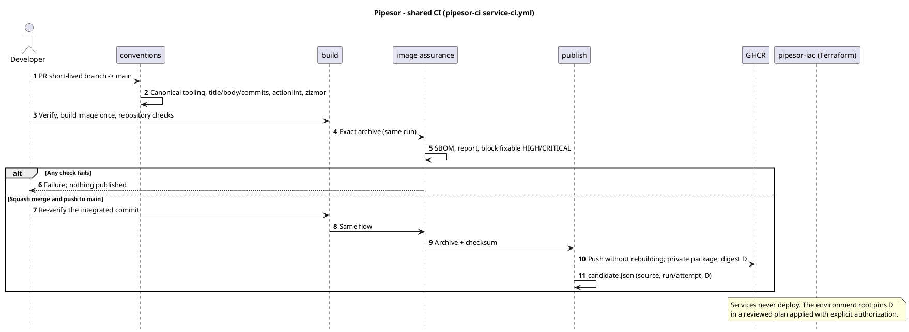
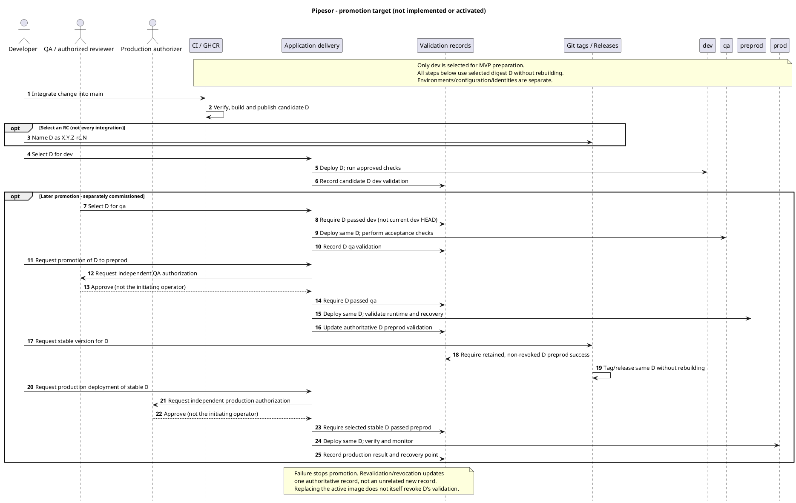

# CI/CD en Pipesor

Estado al 22/11/2026. Esta guía resume las prácticas acordadas y lo implementado en todos los
repositorios. **No es un ADR Accepted** ni autoriza operaciones en Azure. Los comandos, versiones y
contratos de cada pieza viven en su repositorio: [pipesor-ci](https://github.com/pipesor-org/pipesor-ci)
para el pipeline compartido, el README de cada servicio para su verificación y el
[runbook de IaC](https://github.com/pipesor-org/pipesor-iac/blob/main/docs/dev-runtime-deployment.md)
para despliegue, promoción y rollback.

## Autoridad y ubicación de la información

- La [política de contribución](https://github.com/pipesor-org/.github/blob/main/CONTRIBUTING.md)
  gobierna Trunk-Based Development: branches cortas `feature/` o `fix/` desde `main`, Conventional
  Commits en inglés, revisión y squash. No hay rama `develop` ni branches por entorno.
- [ADR-018](../architecture/decisions/ADR-018-application-architecture-ddd-cqrs.md) conserva
  repositorios y ownership por servicio; [ADR-019](../architecture/decisions/ADR-019-align-mvp-with-iac.md),
  [IaC ADR 001](https://github.com/pipesor-org/pipesor-iac/blob/main/docs/adr-001-branching-and-promotion.md)
  y [IaC ADR 004](https://github.com/pipesor-org/pipesor-iac/blob/main/docs/adr-004-mvp-state-and-deployment.md)
  conservan el alcance dev-only, la promoción por SHA/digest y la autorización explícita de cada apply.
- [pipesor-ci](https://github.com/pipesor-org/pipesor-ci) es dueño de los workflows reutilizables,
  de la configuración canónica de commitlint/Lefthook y de la herramienta de release.

## Controles del repositorio

Todos los repositorios de `pipesor-org` son públicos. En GitHub Free eso habilita rulesets, required
checks y Environments con revisores, que antes no estaban disponibles. Desde el 22/11/2026:

- La rama por defecto de cada repositorio tiene un ruleset: PR obligatorio (sin aprobaciones mínimas,
  porque el equipo es pequeño y los agentes publican con la cuenta de un integrante), resolución de
  conversaciones, solo squash, sin force push ni borrado. Los required checks del CI se añaden a esos
  rulesets una vez integrado el CI compartido.
- Los tags `v*` están protegidos contra borrado y movimiento.
- Ajustes de merge uniformes: solo squash con título y descripción del PR, borrado de la rama tras el
  merge y auto-merge habilitado.
- Las imágenes en GHCR siguen siendo privadas; el publicador compartido lo verifica en cada push.

## Pipeline compartido

| Pieza | Qué hace |
|---|---|
| `conventions.yml` | Configuración canónica de commitlint/Lefthook (falla ante desviaciones), título de PR de hasta 65 caracteres y descripción no vacía, Conventional Commits del rango del PR y del commit integrado en `main`, actionlint y zizmor. Lo ejecutan todos los repositorios. |
| `container-build.yml` | Verificación del repositorio, una sola construcción `ghcr.io/<repo>:sha-<sha>-<run>-<attempt>`, etiqueta OCI de revisión, usuario no root, chequeos propios del repositorio y traspaso del archivo exacto (artifact de un día). |
| `image-assurance.yml` | SBOM CycloneDX y reporte de vulnerabilidades con Trivy (evidencia de 90 días); bloquea HIGH/CRITICAL con versión corregida. Las excepciones revisadas van en `.trivyignore.yaml` con issue y vencimiento. |
| `publish-container.yml` | Solo push a `main`: carga el archivo verificado, mantiene privado el paquete, publica sin reconstruir y registra `candidate-<run>-<attempt>/candidate.json` (90 días). |
| `service-ci.yml` | Compone las cuatro piezas anteriores con la sintaxis `uses: $/...`. |
| `actions/release` | Nombra un digest existente con `vX.Y.Z[-rc.N]` y una GitHub Release; nunca reconstruye ni re-etiqueta el registro. |

Los consumidores fijan el SHA completo del tag (`v1.0.0`) con un comentario de versión; Dependabot
(`github-actions`, semanal, cooldown de 7 días) propone actualizaciones. Todas las acciones de terceros
están fijadas por SHA y las imágenes de herramientas por digest.

## Estado por repositorio

| Repositorio | CI | Artefacto | Estado |
|---|---|---|---|
| 5 servicios Java | `service-ci.yml` (Maven) | Imagen + `candidate.json` | Publicando desde `main`; release deshabilitado en código; excepciones Trivy con vencimiento 06/12/2026 (apt de la base y `proton-j`) con issues de remediación |
| `pipesor-nlp-log-processor`, `pipesor-rag-retrieval` | `service-ci.yml` (Python) | Imagen + `candidate.json` | Publicando; sus validadores propios fueron reemplazados por commitlint; RAG ya no re-etiqueta GHCR (`promote-release` retirado) |
| `pipesor-frontend` | `service-ci.yml` (Bun) | Imagen nginx + `candidate.json` | Build Once: el contenedor genera `/config.js` y la CSP desde `PIPESOR_*_URL` al arrancar; IaC define esas variables |
| `pipesor-iac` | `conventions.yml` + matriz Terraform + tooling | — | Sin credenciales ni plan real en CI |
| `pipesor-docs` | `conventions.yml` + validadores de modelos | — | `make test` y validaciones de presentación aún fallan en `main` ([#36](https://github.com/pipesor-org/pipesor-docs/issues/36)) |
| `pipesor-landing` | `conventions.yml` + checks/test/build/dry-run | Workers | El despliegue sigue en Workers Builds |
| `pipesor-workspace`, `.github`, `pipesor-ci` | `conventions.yml` + tests propios | — | La capa compartida anterior de workspace se retiró |

## Identidad, versiones y retención

La **identidad técnica**, la **versión de release** y el **destino desplegado** son conceptos distintos.
El digest es la identidad; el tag técnico es único por run/attempt y un reintento no crea una nueva
versión SemVer. `candidate.json` schema 1 (`source_sha`, `image`, `digest`, `build_run_id`,
`build_run_attempt`) es el traspaso hacia releases y entornos. La herramienta de release verifica que
el candidato provenga de un push exitoso de `ci.yml` en `main` y su ancestría.

RC `X.Y.Z-rc.N` es opcional. Antes de una base estable 1.x se exige un objetivo `X.Y.Z` explícito y
creciente; desde 1.x, breaking → major, feat → minor, el resto → patch. Las versiones publicadas no se
sobrescriben. Stable exige validación preprod retenida para el mismo digest, así que en dev-only no se
publica stable. El hotfix organizacional no está implementado.

GHCR conserva las imágenes; **no hay limpieza automática**. `pipesor-pipeline-service` mantiene el
preview local de retención (sin capacidad de borrado). Las evidencias de candidato y aseguramiento
duran 90 días; si se necesita más para una promoción o recuperación, se revalida. La retención
funcional de [ADR-013](../architecture/decisions/ADR-013-retention-365-days.md) no se satisface ni
redefine con estas retenciones técnicas.

## Despliegue, promoción y rollback

**Decisión del 22/11/2026 (Jhon y Ramiro, por mejor ajuste a las prácticas buscadas):** el root
Terraform de cada entorno es el **único dueño de la imagen desplegada**. Motivos: un solo escritor del
estado deseado (sin reconciliación competitiva entre Terraform y un adaptador imperativo), plan
revisado por entorno según IaC ADR 001, promoción del mismo digest entre roots, ninguna credencial de
Azure ni runner self-hosted en repositorios públicos de aplicación, y un flujo ya probado en el
despliegue integral de dev. Por eso se retiraron los `deploy.yml`, el adaptador ACA image-only y su
rollback de los cinco servicios Java.

- **Desplegar:** tomar el `image@digest` de `candidate.json`, ponerlo en `workloads.images` del root,
  generar un plan nuevo, revisar que solo cambie la Container App esperada y aplicarlo con
  autorización.
- **Promover:** el mismo digest en el root del siguiente entorno, con su propio plan revisado; nunca se
  reutiliza un plan ni un state.
- **Rollback:** un plan revisado nuevo con el digest anterior. No hay downgrade SQL ni restauración de
  state implícitos; una incompatibilidad de esquema o configuración obliga a revisar un forward fix.
- **Configuración:** variables y referencias a secretos las aporta el root; ningún valor secreto vive
  en la imagen ni en los manifiestos. El frontend lee sus orígenes en runtime para que su digest sea
  promovible.

El objetivo organizacional de despliegue automático a dev no está activo: cada apply sigue requiriendo
autorización explícita (ADR 004). Automatizarlo exige identidad OIDC por entorno, un runner validado y
un gate aceptado.

## Future environment promotion (TO-BE)

**Design target, not a commissioned or implemented multi-environment workflow.** The current execution footprint remains dev only: the dev Terraform root pins every image by digest and is applied on demand with explicit authorization; CI runs independently and continues verifying/publishing successful main candidates without assigning RCs. An environment is an execution/configuration/data/identity boundary, not an artifact version. A given digest can be installed in several environments at the same time, and each microservice can advance independently. No environment branches or environment-specific image rebuilds are introduced.

The TO-BE follows the future environments retained by [IaC ADR 001](https://github.com/pipesor-org/pipesor-iac/blob/main/docs/adr-001-branching-and-promotion.md) and [ADR 004](https://github.com/pipesor-org/pipesor-iac/blob/main/docs/adr-004-mvp-state-and-deployment.md): dev → qa → preprod → prod. `preprod` is the project's staging name. This section neither changes those ADRs nor provisions their future roots. DORA's [same process/packages across environments](https://dora.dev/capabilities/deployment-automation/) is an engineering recommendation; the chosen environment names/order and approval rules are project decisions.

| Stage | Purpose and prerequisite for selected digest D | Preserved evidence |
|---|---|---|
| CI | Verify integrated main; build/test/publish D once. A successful CI run alone does not certify production readiness. | Source SHA, original CI run/attempt, digest and test results. |
| dev | Select D explicitly; check approved runtime/integration behavior. Main/dev may subsequently advance without changing D's identity. | Environment/configuration references, deployment result and candidate validation result. |
| qa | Promote D after its dev validation. Keep D stable for selected functional/regression acceptance while dev can run another digest. | Same identity plus applicable test results and acceptance. |
| preprod | Promote D after QA acceptance and the required independent QA sign-off; validate production-like dependencies/configuration and recovery where applicable. | Candidate-scoped validation and authorization evidence. |
| Stable release | Name D after its successful preprod qualification; an RC is optional and does not imply a different image. | New Git tag and Release manifest mapping version to D. |
| prod | Deploy that stable release's D after preprod qualification and required independent production authorization. | Production target/config references, result, monitoring/functional validation and recovery point. |

Future permissions/identities and target mappings must be environment-scoped; operators must not turn arbitrary dispatch IDs into deployment authority. Each promotion is an environment-specific reviewed Terraform plan that pins D, serialized per state. Configuration, secret-version references and data are supplied separately; no secret values are stored in image/validation manifests. Promotion checks the selected digest's qualification, not whether it is still the current image in the previous environment. A functional fix produces a new candidate and repeats the relevant validation path. Terraform still generates an environment-specific reviewed plan; application digest reuse never means reusing Terraform plans/states.

### Candidate validation versus active deployment

The prepared stable gate consumes a **proposed Pipesor producer contract**, not a built-in GitHub approval mechanism. For each repository/environment/source SHA/digest, maintain one authoritative validation Deployment record with `payload.image` and `payload.validation_scope="candidate"`. Ordinary runtime Deployment records can track what is currently active separately. The producer must serialize/reuse the validation record: start revalidation with pending/in_progress; conclude with success/failure/error; revoke acceptance with failure/error on that same record. Creating a new failed record does not revoke an older success and duplicates are rejected by the consumer.

Publish validation statuses with `auto_inactive=false`. GitHub's [default auto-inactive behavior](https://docs.github.com/en/rest/deployments/statuses#create-a-deployment-status) otherwise replaces earlier success with inactive when another deployment succeeds. In this explicit candidate-validation contract inactive describes lifecycle only, not withdrawal of acceptance. The gate permits inactive only with a retained, unambiguous preceding success and no later non-inactive failure or unfinished/unknown state. It rejects ordinary inactive records, duplicate authoritative records, invalid chronology and unavailable history. GitHub retains historical statuses for a limited period; if required proof has expired, revalidate instead of inferring approval. Record IDs/logs/configuration and acceptance references must remain traceable while the candidate is eligible for promotion or recovery.

The dev procedural approval exception is not extended to qa/preprod/prod. The repositories are now public, so GitHub Environments with required reviewers and self-review prevention are available on the current plan; they must be configured and accepted before those stages are activated. The validation producer, functional gates, per-environment mappings and enforcement are TO-BE dependencies, not implemented by a metadata field. No statement in this section treats a boolean marker as proof of human approval.

## Referencias y decisiones aún abiertas

[DORA: deployment automation](https://dora.dev/capabilities/deployment-automation/) recomienda
paquetes/procesos repetibles entre entornos; [SemVer](https://semver.org/) define formato, precedencia
e inmutabilidad. Los nombres/orden de entornos y los gates son decisiones del proyecto.

Pendientes que esta guía no cierra: remediar las excepciones Trivy antes del 06/12/2026; restaurar la
suite de pipesor-docs y añadirla a los required checks; configurar Environments con revisores
independientes antes de qa/preprod/prod; productor de validaciones de candidato y retención de
evidencia; despliegue automático a dev con OIDC; atestaciones de procedencia (SLSA) para las imágenes;
PD-035 (contratos runtime y datos) y la recuperación cloud real.
