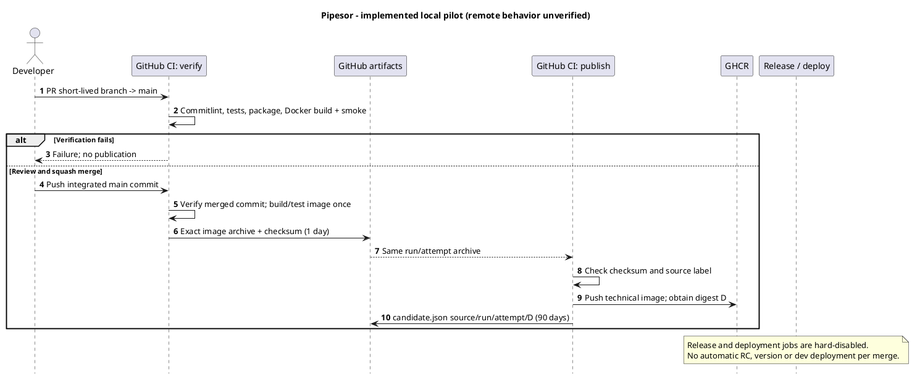
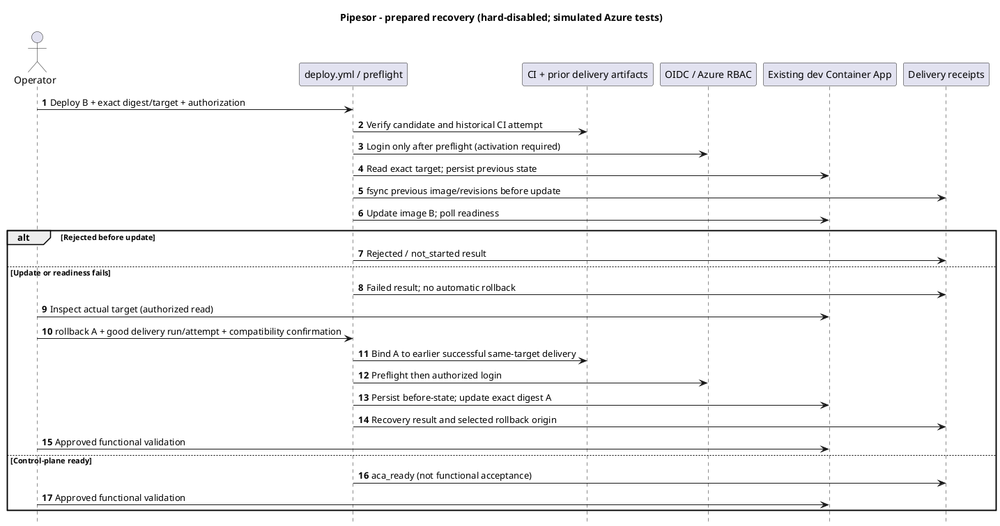
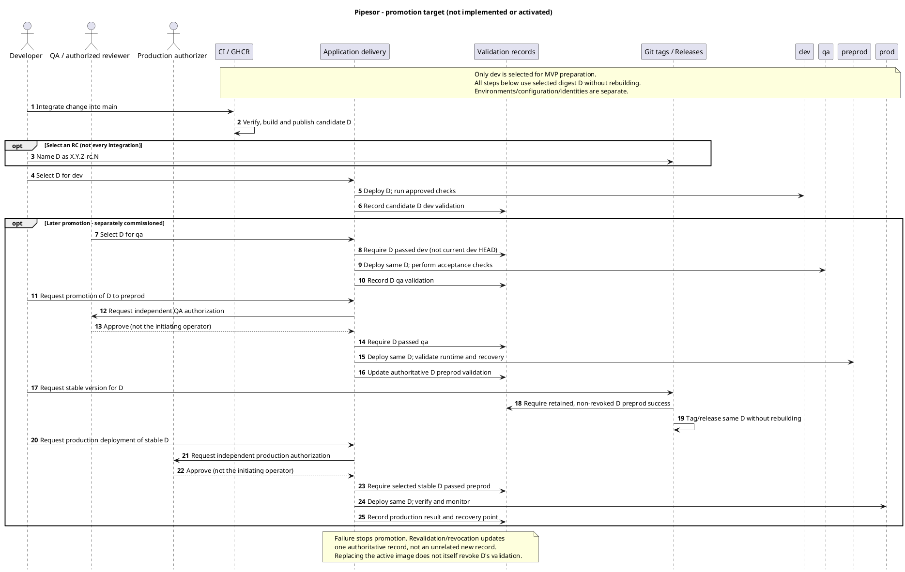

# CI/CD: base del piloto y adopción en Pipesor

Estado al 08/11/2026: implementación local de `pipesor-pipeline-service` preparada
para revisión e integración. Esta guía registra lo implementado y orienta su
extensión; **no es un ADR Accepted, autorización de Azure ni certificación del
estándar en los demás repositorios**. Las referencias a main describen el destino
de integración; hasta que se fusionen los PRs, consultar sus ramas para ver los
cambios. No se modifican modelos, ADRs ni contratos pendientes.

Revisión de implementación preparada para integración en el servicio:
`18f3a14b24e63aef947bc1d5eff67e93eb33d1fd`; baseline documental consultada:
`pipesor-docs@e22627cfee10b0b02edab084b98eb18926c678b5`, e IaC:
`4b42c0c8e66578dfb890ae1cca8c9c31c774026e`. Los cambios locales de otro trabajo en
`model/domain_decisions.md` no se incorporan ni se toman como aprobación CI/CD.

## Autoridad y ubicación de la información

- La [política de contribución](https://github.com/pipesor-org/.github/blob/main/CONTRIBUTING.md)
  gobierna branches cortas `feature/` o `fix/` desde main, Conventional Commits,
  revisión y squash. No hay rama develop ni branches por entorno.
- [ADR-018](../architecture/decisions/ADR-018-application-architecture-ddd-cqrs.md)
  conserva repositorios y ownership por servicio; [ADR-019](../architecture/decisions/ADR-019-align-mvp-with-iac.md)
  y [IaC ADR 004](https://github.com/pipesor-org/pipesor-iac/blob/main/docs/adr-004-mvp-state-and-deployment.md)
  conservan preparación dev-only, readiness de los servicios y autorización
  específica antes de bootstrap, identidades, state o despliegue.
- Esta guía concentra principios, límites, contratos de evidencia propuestos y
  adaptación entre tecnologías. El [README del piloto](https://github.com/pipesor-org/pipesor-pipeline-service/blob/main/README.md#ci-images-and-disabled-delivery)
  es dueño de comandos, versiones de herramientas y procedimientos operativos,
  incluido el [runbook de rollback](https://github.com/pipesor-org/pipesor-pipeline-service/blob/main/README.md#rollback-implementation-and-runbook).
  Su [deployment contract](https://github.com/pipesor-org/pipesor-pipeline-service/blob/main/docs/deployment-contract.md)
  conserva configuración, accesos, dependencias y readiness específicos. El
  [runbook IaC](https://github.com/pipesor-org/pipesor-iac/blob/main/docs/mvp-deployment-runbook.md)
  conserva planes, state, custodia y operaciones de infraestructura.

## Estado real y límites de evidencia

| Capacidad | Estado del piloto | Pendiente |
|---|---|---|
| PR/main CI | Workflow implementado: commitlint, pruebas Java/PostgreSQL, empaquetado, imagen no root y smoke local | Primera ejecución hosted de PR/main; checks no equivalen a merge protegido |
| Publicación GHCR | Job separado, solo push main; carga la misma imagen comprobada, sin reconstruir | Permisos/package access, transferencia real de artifacts y publicación por GitHub |
| Release RC/stable | Implementada y **deshabilitada en código**; manifiesto de versión al mismo digest | Activación autorizada; productor preprod para stable |
| Deploy y rollback dev | Adaptador ACA image-only, operación explícita rollback, **deshabilitados en código** | Readiness, ownership, runner, OIDC/RBAC, pull privado, pruebas reales |
| Retención | Inventario/protecciones locales → preview sin credenciales ni borrado | Inventario completo y política aprobada antes de implementar limpieza |
| Promoción entre entornos | TO-BE documentado | Destinos, validadores, controles independientes y pruebas de mismo digest |

`release.yml` y `deploy.yml` contienen `false && ...` en el job: ningún dispatch
ni variable puede activarlos. La integración de estos archivos no aprueba su
activación. No hay recursos Azure creados por esta tarea. D03 no está aprobada;
el laboratorio V1–V5 y D03-EXP quedan suspendidos. ACA Jobs, el bootstrap de
identidades y la gestión de credenciales GHCR no quedan validados por pruebas
locales con respuestas simuladas.

## Flujo implementado: verificación, artefacto y despliegue

CI no es un entorno Azure. Un build de comprobación de PR no se publica. Tras
integrar en main se vuelve a verificar el commit integrado, se empaqueta el JAR y
se construye/prueba la imagen una vez. Un job con `packages: write` recibe el
archivo exacto con checksum, verifica su revisión de origen y lo publica en GHCR.
La verificación no recibe permisos de publicación ni credenciales cloud.

La etiqueta técnica es `sha-<SHA completo>-<run>-<attempt>`; el despliegue consume
`ghcr.io/<repositorio>@sha256:<digest>`. `candidate.json` schema 1 contiene
`source_sha`, `image`, `digest`, `build_run_id`, `build_run_attempt`. El consumidor
comprueba la ejecución/attempt histórica de CI: mismo repositorio, workflow,
push main y éxito; también ancestry en main. El tag mutable no sustituye al
digest. Una etiqueta/run nuevo tras un reintento no es una nueva release SemVer.

La concurrencia de PR cancela verificaciones obsoletas. Main no cancela el job
activo, pero GitHub puede reemplazar runs pendientes: no se garantiza un artefacto
por cada merge en una ráfaga. Fallar CI impide publicación. Si falla publicación,
revisar el estado remoto y repetir el workflow completo, no solo el job fallido:
los artifacts y la etiqueta incorporan el attempt. No modificar candidatos previos.

## Versiones, paquetes y retención

La **identidad técnica**, la **versión de release** y el **destino desplegado** son
conceptos distintos. Cincuenta integraciones pueden producir candidatos técnicos
sin producir ningún RC ni versión estable. El operador selecciona cuándo nombrar
un candidato; RC `X.Y.Z-rc.N` es opcional, no una etapa obligatoria de CI.

La implementación prepara tags `vX.Y.Z[-rc.N]` y GitHub Release con notas y
`candidate.json`, sin reconstrucción ni retag GHCR. Antes de una base estable 1.x,
se exige objetivo explícito `X.Y.Z` creciente; breaking en 0.x no declara 1.0
automáticamente. Desde base estable 1.x: breaking → major, feat → minor, otros
cambios seleccionados → patch; prevalece el mayor impacto desde el mayor tag
estable ancestral del candidato. RC retenido → stable conserva X.Y.Z. Estas son
convenciones del piloto, no obligaciones de [SemVer](https://semver.org/).
Versiones publicadas no se sobrescriben. El flujo excepcional hotfix de la
política organizacional **no está implementado** por este piloto.

Stable mantiene el gate preprod de la política existente. Dev-only no lo omite:
sin productor/validación preprod no se puede publicar stable. El proceso
main → dev bajo demanda difiere del objetivo organizacional de dev automático:
es una preparación explícita del MVP; no cambia las reglas futuras. La selección
manual de versiones 0.x y el contrato de evidencia preprod deben revisarse al
adoptar el estándar, sin alterar unilateralmente CONTRIBUTING ni ADRs.

La entrega del backend es la imagen, no una biblioteca Maven/PyPI. El SNAPSHOT
del POM es metadata interna, no identidad de entrega. Dependencias y base image
están fijadas; actualizarlas requiere volver a validar, no reconstruir una release
existente para promocionarla. No se publica un paquete adicional sin consumidor.

GHCR conserva las imágenes: **no hay limpieza automática**. El preview protege
releases RC/stable, digests activos/en curso/seleccionados y de rollback con
snapshot completo verificado de hasta 24 h. Propone solo etiquetas técnicas
reconocidas, antiguas y no protegidas; conserva las diez más recientes por
defecto (edad 30 días). Son defaults revisables de preview, no política de borrado
aprobada. Evidencia ausente/obsoleta lo rechaza; no alimentarlo directamente a un
borrado. Evidencia original y manifiestos deben durar mientras haya elegibilidad
para release/promoción/recuperación: 90 días de artifact no garantizan ese plazo.
La retención funcional de [ADR-013](../architecture/decisions/ADR-013-retention-365-days.md)
no se satisface ni redefine con estas retenciones técnicas.

## Responsabilidades y controles de activación

| Owner | Responsabilidad y frontera |
|---|---|
| Servicio | Código/tests, dependencias, imagen/manifiesto, compatibilidad de schema/API y requisitos runtime; comandos y runbook propios |
| Infraestructura | Fundaciones/red/entorno, state/planes, recursos/identidades y grants aprobados; no consumir implícitamente un contrato de readiness |
| Aplicación, pendiente de aceptación | Un owner para provisión/configuración de la app y su imagen; el adaptador preparado solo actualiza imagen de una app existente |
| Operador dev | Revisión/autorización exacta, coordinación de writes, compatibilidad y aceptación funcional tras readiness |

Preparar el adaptador nativo **no decide** Terraform frente a ACA nativo como
estándar global. Antes de activarlo hay que aceptar propiedad de imagen/config,
evitar reconciliación competitiva de Terraform y coordinar configuración,
provisioning y recuperación. `ignore_changes` aislado no constituye un contrato.
Si se conserva Terraform como owner de imagen, sustituir el adaptador inactivo
bajo revisión. No se reutilizan planes Terraform entre estados/entornos.

GitHub Free/private no aporta los required reviewers/protecciones de entorno
asumidos en el modelo EY. El piloto no usa environment secrets ni gates no
contratados. Review/squash y autorización por issue/PR son procedimientos humanos;
una URL no demuestra aprobación independiente. OIDC autentica, Azure RBAC
autoriza; ambos son distintos de permisos GitHub y de la identidad runtime/pull
privado. Trust main del repositorio exacto y RBAC mínimo sobre la app existente
requieren configuración y validación separadas; app-write no es permiso solo de
imagen. No se añade Contributor de suscripción ni grants de infraestructura por
comodidad. Ver [disponibilidad por plan](https://docs.github.com/en/actions/reference/workflows-and-actions/deployments-and-environments).

Prerrequisitos de activación, todos pendientes de evidencia real: readiness e
integración de servicios según ADR 004; runtime/config/probes/migraciones/acceso
PostgreSQL Entra y audit; app/env/container existentes en modo Single; ownership
aceptado y exclusión de writes concurrentes; pull GHCR privado; runner Debian
limpio de un job, CLI/dependencias/red cualificados; identidad/trust/RBAC y coste;
autorización explícita del destino/acción y eliminación revisada del disable.
La [lista operativa del piloto](https://github.com/pipesor-org/pipesor-pipeline-service/blob/main/README.md#ci-images-and-disabled-delivery)
conserva los nombres exactos de variables e inputs.

## Recuperación y validación

Rollback es un dispatch explícito de la misma ruta serializada, no una reacción
automática ni un Git revert. Requiere un candidato publicado y un run/attempt de
entrega anterior exitoso para el mismo destino, con receipt versionado y
`aca_ready`, más confirmación humana de aceptación funcional y compatibilidad
actual de schema/config. Verifica productor/origen/digest antes de Azure. Escribe
antes de mutar el estado previo permitido y después el resultado; conserva
request y receipts por 90 días. Se vuelve a desplegar el digest A, sin construir
ni asignar otra versión. Una nueva revisión ACA no es requisito de idempotencia:
mismo digest/config puede conservar la revisión. El receipt histórico no implica
que se reactive esa misma revisión histórica.

No hay downgrade SQL, restauración de state, recreación de app, traffic splitting
ni recuperación de configuración en este rollback. Un fallo de actualización puede
haber mutado la app: inspeccionar antes de decidir. Falta de evidencia, competencia
de writes o compatibilidad incierta obliga a detenerse y revisar un forward fix o
recuperación por el owner. Perder el runner puede impedir subir receipts; fsync
local no es backup independiente. El runbook del servicio contiene los comandos.

Las pruebas significativas cubren guards, procedencia, fallos de storage/readiness,
A listo → B falla → rollback explícito A y preview de retención. Respuestas GitHub/
Azure simuladas no prueban APIs ni permisos reales. `act` + Docker/WSL2 ejecuta solo
el job verify, sin credenciales, publicación o deploy; omite artifacts/cache y no
emula OIDC, permisos, concurrency ni approvals. `actionlint` complementa sintaxis;
la ejecución registrada omite ShellCheck. Reservar PR metadata real, artifacts,
GHCR, OIDC/RBAC y ACA para ejecuciones autorizadas en sus plataformas. Ver
[limitaciones act](https://nektosact.com/not_supported.html) y el registro de
verificación del README; no duplicar aquí su lista de comandos.

## Extensión proporcional a otros repositorios

Esta tabla es una **guía de adopción**, no cambios implementados en otros servicios.
Primero implantar un segundo consumidor y comprobar el contrato; solo entonces
extraer un reusable workflow si elimina duplicación real. No crear una plataforma,
biblioteca de scripts o matriz común por anticipado.

| Artefacto | Reutilizar | Adaptar/verificar antes de adopción |
|---|---|---|
| Otros Java/Spring | PR/main, commitlint/Lefthook, publish separado, imagen por digest y evidencia | Wrapper/JDK/dependencias, nombre del JAR, tests/fixtures y smoke propios; contratos DB/migración/ingress, sin copiar permisos ni schemas de Pipeline |
| Python/FastAPI (`pipesor-nlp-log-processor`, `pipesor-rag-retrieval`) | Stages, identidad OCI/manifiesto, no root, mismo digest y guards | Build/test del proyecto, Python compatible y dependencias resueltas reproduciblemente; no imponer Maven/JPA/PostgreSQL al servicio sin tablas. NLP ya tiene código/pyproject/Dockerfile y Quality CI con pytest/compileall y startup negativo (exit 2); conservar esos checks, sin afirmar ejecución hosted/GHCR/ACA ni copiar un smoke HTTP. RAG sigue documental: no hay build/imagen que extender todavía. No elegir un package manager adicional aquí |
| React SPA (`pipesor-frontend`) | Verificar PR/main, dependencias lockeadas, conservar el resultado comprobado y source/run/hash | Unidad `dist/` archivada con hash/manifiesto, no imagen ACA. CI de frontend ya construye/sube dist; falta demostrar consumo sin rebuild y rollback en SWA. Identidad, permisos y rollback son específicos de SWA |
| Terraform | CI sin apply/credenciales PR, dependencias fijadas, SHA/evidencia, autorización explícita | Plan por root/state/inputs, custodia/backup y locks según IaC; nunca promover el mismo plan entre estados |
| Docs/modelos y otros sitios | Checks pertinentes y trazabilidad de outputs | Usar sus propios comandos/generadores; no aplicar build de app ni deploy ACA a toda modificación documental. Landing conserva su contrato Workers, distinto de SPA/SWA |

En SPA, [Vite sustituye variables en build](https://vite.dev/guide/env-and-mode#env-variables):
compilar por entorno con distintas `VITE_*` cambia los bytes. Antes de afirmar
Build Once, Deploy Many hay que acordar cómo separar configuración pública del
bundle, o documentar explícitamente esa limitación. Nunca incluir secretos en
configuración del navegador. Microsoft documenta [SWA con frontend precompilado](https://learn.microsoft.com/en-us/azure/static-web-apps/build-configuration#skip-building-front-end-app)
(`skip_app_build`); su disponibilidad no prueba el flujo de promoción ni decide
aquí su autenticación. No trasladar los scopes/CLI/OIDC de ACA a SWA por analogía.
ACA Jobs también requiere validar create/update, ejecución, completitud y rollback
propios: los tests de Container Apps no los cubren.

## Future environment promotion (TO-BE)

**Design target, not a commissioned or implemented multi-environment workflow.** The current execution footprint remains dev only, deployed on demand; CI runs independently and continues verifying/publishing successful main candidates without assigning RCs. An environment is an execution/configuration/data/identity boundary, not an artifact version. A given digest can be installed in several environments at the same time, and each microservice can advance independently. No environment branches or environment-specific image rebuilds are introduced.

The TO-BE follows the future environments retained by [IaC ADR 001](https://github.com/pipesor-org/pipesor-iac/blob/main/docs/adr-001-branching-and-promotion.md) and [ADR 004](https://github.com/pipesor-org/pipesor-iac/blob/main/docs/adr-004-mvp-state-and-deployment.md): dev → qa → preprod → prod. `preprod` is the project's staging name. This section neither changes those ADRs nor provisions their future roots. DORA's [same process/packages across environments](https://dora.dev/capabilities/deployment-automation/) is an engineering recommendation; the chosen environment names/order and approval rules are project decisions.

| Stage | Purpose and prerequisite for selected digest D | Preserved evidence |
|---|---|---|
| CI | Verify integrated main; build/test/publish D once. A successful CI run alone does not certify production readiness. | Source SHA, original CI run/attempt, digest and test results. |
| dev | Select D explicitly; check approved runtime/integration behavior. Main/dev may subsequently advance without changing D's identity. | Environment/configuration references, deployment result and candidate validation result. |
| qa | Promote D after its dev validation. Keep D stable for selected functional/regression acceptance while dev can run another digest. | Same identity plus applicable test results and acceptance. |
| preprod | Promote D after QA acceptance and the required independent QA sign-off; validate production-like dependencies/configuration and recovery where applicable. | Candidate-scoped validation and authorization evidence. |
| Stable release | Name D after its successful preprod qualification; an RC is optional and does not imply a different image. | New Git tag and Release manifest mapping version to D. |
| prod | Deploy that stable release's D after preprod qualification and required independent production authorization. | Production target/config references, result, monitoring/functional validation and recovery point. |

Future permissions/identities and target mappings must be environment-scoped; operators must not turn arbitrary dispatch IDs into deployment authority. Reuse the deployment process, with locks per service/environment and explicit coordination with the infrastructure owner. Configuration, secret-version references and data are supplied separately; no secret values are stored in image/validation manifests. Promotion checks the selected digest's qualification, not whether it is still the current image in the previous environment. A functional fix produces a new candidate and repeats the relevant validation path. Terraform still generates an environment-specific reviewed plan; application digest reuse never means reusing Terraform plans/states.

### Candidate validation versus active deployment

The prepared stable gate consumes a **proposed Pipesor producer contract**, not a built-in GitHub approval mechanism. For each repository/environment/source SHA/digest, maintain one authoritative validation Deployment record with `payload.image` and `payload.validation_scope="candidate"`. Ordinary runtime Deployment records can track what is currently active separately. The producer must serialize/reuse the validation record: start revalidation with pending/in_progress; conclude with success/failure/error; revoke acceptance with failure/error on that same record. Creating a new failed record does not revoke an older success and duplicates are rejected by the consumer.

Publish validation statuses with `auto_inactive=false`. GitHub's [default auto-inactive behavior](https://docs.github.com/en/rest/deployments/statuses#create-a-deployment-status) otherwise replaces earlier success with inactive when another deployment succeeds. In this explicit candidate-validation contract inactive describes lifecycle only, not withdrawal of acceptance. The gate permits inactive only with a retained, unambiguous preceding success and no later non-inactive failure or unfinished/unknown state. It rejects ordinary inactive records, duplicate authoritative records, invalid chronology and unavailable history. GitHub retains historical statuses for a limited period; if required proof has expired, revalidate instead of inferring approval. Record IDs/logs/configuration and acceptance references must remain traceable while the candidate is eligible for promotion or recovery.

The dev procedural approval exception is not extended to qa/preprod/prod. GitHub Free/private cannot supply the assumed protected-environment independent reviewer gates; future stronger authorization/enforcement must be accepted before those stages are activated. The validation producer, functional gates, per-environment mappings and enforcement are TO-BE dependencies, not implemented by the current dev adapter or by a metadata field. No statement in this section treats a boolean marker as proof of human approval.

## Referencias y decisiones aún abiertas

[DORA: deployment automation](https://dora.dev/capabilities/deployment-automation/)
recomienda paquetes/procesos repetibles e idempotentes entre entornos; es una
recomendación de ingeniería, no exigencia de dev automático ni cuatro entornos.
[SemVer](https://semver.org/) define formato, precedencia e inmutabilidad, no cuándo
crear una release. Los nombres/orden de entornos y los gates son decisiones del
proyecto; las convenciones 0.x y el formato de manifests son del piloto.

Referencias técnicas del adaptador: [ACA update](https://learn.microsoft.com/en-us/cli/azure/containerapp#az-containerapp-update),
[revisiones Single](https://learn.microsoft.com/en-us/azure/container-apps/revisions#revision-modes),
[OIDC Azure](https://docs.github.com/en/actions/how-tos/secure-your-work/security-harden-deployments/oidc-in-azure)
y [artifact handoff](https://docs.github.com/en/actions/how-tos/writing-workflows/choosing-what-your-workflow-does/storing-and-sharing-data-from-a-workflow).
Estos documentos describen capacidades, no evidencia de que estén configuradas.

Pendientes que este registro no cierra: PD-035/contratos runtime y datos; propiedad
Terraform/ACA y coordinación; productor de validaciones/retención de evidencia;
autorización independiente futura; recuperación cloud real y adopción de cada
artefacto. La aprobación de estos PRs integra la preparación local y esta guía;
no elimina los requisitos previos de activación ni resuelve esos asuntos.
